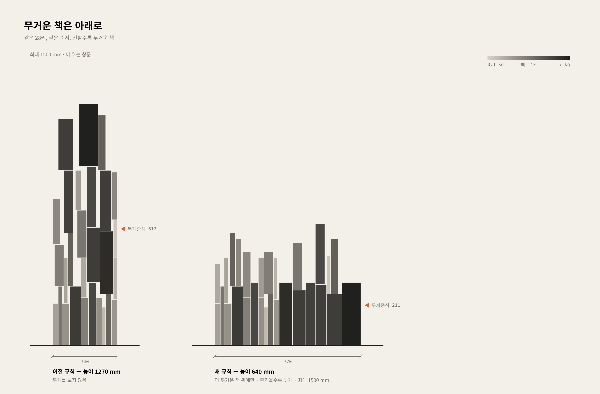
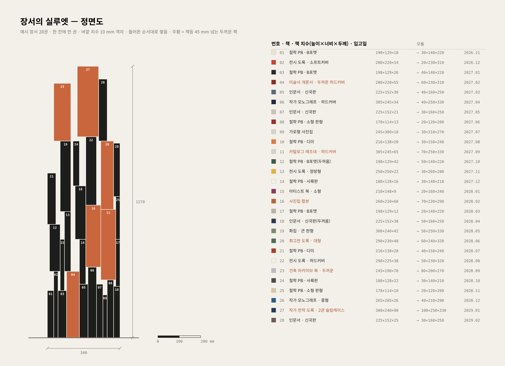
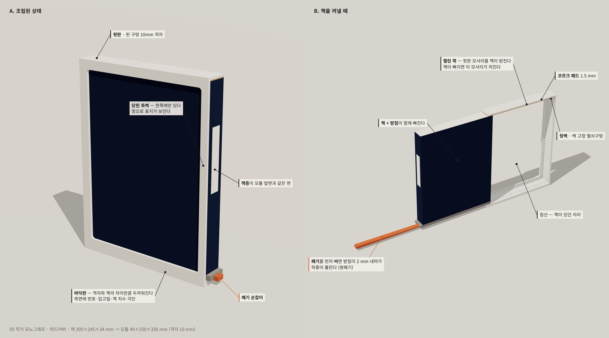

# 책 한 권 = 칸 하나인 책장

책 치수 세 개(높이·너비·두께)를 재면 그 책만을 위한 칸이 3D 프린터용 파일로 나오고,
칸을 하나씩 쌓아 갈수록 책장 윤곽이 장서의 실루엣이 된다.


## 구조 개념

- **바깥은 격자, 안은 책**: 모듈 바깥 치수는 10 mm 격자로 올림하고 안쪽만 책에 딱 맞춘다.
  그 차이는 측벽·뒷벽·바닥판 두께가 흡수한다. 그래서 어떤 모듈끼리도 쌓이고, 위아래는 격자 위의 Ø4 핀으로 맞물린다.
- **책이 네 번째 벽**: 측벽은 한쪽에만 있다(C자 단면). 반대쪽 윗판 모서리는 책이 받친다.
  책이 빠지면 그 칸은 약해진다. 빈 칸에는 같은 치수의 대리 블록을 끼우는 것을 전제로 한다.
- **쌍쐐기로 꺼내기**: 책 밑에 받침(shoe)과 쐐기(wedge)가 겹쳐 있다. 쐐기를 먼저 빼면 받침이 2 mm 내려가
  위에서 누르던 하중이 풀리고, 책은 받침째 가볍게 빠진다.
- **쌓는 규칙**: 들어온 순서대로, 지금 형태에서 가장 낮고 아래 모듈이 받쳐 주는 자리에 놓는다
  (닿는 면이 중심을 포함하고, 깊이의 75%·면적의 40% 이상). 여기에 무게와 높이 조건이 붙는다.
  - 책은 자기보다 무겁거나 같은 책 위에만 올라간다.
  - 무거울수록 낮은 곳에서만 시작할 수 있다 (0.1 kg은 최대 높이까지, 7 kg은 바닥만, 로그 척도).
  - 최대 높이 1500 mm. 놓을 곳 위에 창문이 있어서다.
  - 자리가 없으면 옆으로 넓힌다. 그래서 무거운 책이 들어오면 책장은 위가 아니라 옆으로 자란다.
- **무게**: `books.json`에 `"kg"`이 있으면 그 값, 없으면 판형 부피로 추정한다 (미술책 1.0, 페이퍼백 0.65 g/cm³).
  실제 책은 저울로 재서 넣는 게 정확하다.
- 예시 28권(책 무게 합 약 44 kg)은 무게를 보지 않던 이전 규칙에서 340 × 1270 mm, 무게중심 612 mm였고,
  지금 규칙에서는 770 × 640 mm, 무게중심 211 mm다. 비교는 `renders/rule.png`.


- **엇쌓기** (`layout.py --bond`): 바닥이 아닌 칸은 아래 칸 두 개 이상에 걸쳐야 한다. 높이 차이는 10 mm 단위
  괴임 블록으로 메운다. 아래 책 하나를 빼도 위 칸이 빈자리를 건너 옆 칸으로 하중을 넘긴다.
  엄격한 조건(괴임 ≤ 40)에서는 28권 중 5권만 위로 올라가 990 × 650 mm로 넓게 퍼지고, 완화한 조건
  (`--max-shim 80 --deep-min 0.6 --weight-ratio 0`)에서는 11권이 올라가 810 × 850 mm다. 그림은 `renders/bond/`.
- **스페이서 받침** (`layout.py --spacer --target 500`): 위 칸마다 계단형 받침을 하나씩 깐다. 윗면은 10 mm 판,
  밑은 아래 칸들 높이에 맞춘 다리. 받침은 위 칸보다 양옆으로 40 mm까지 넓어져서 좁은 칸도 이웃 칸까지 걸치고,
  아래 칸 두 개 이상을 핀으로 묶어 줄눈을 건너는 짧은 보가 된다. 예시 28권: 850 × 780 mm, 위 칸 10개 모두
  두 칸 이상에 걸침, 다리 최대 110 mm. 그림은 `renders/spacer/`.
- **골조형** (`skeletal = true`, `layout.py --skeletal`): 윗판·바닥판·뒷벽에 갈빗대만 남긴다. 갈빗대는 벽에서
  20·60·100 mm … 40 mm 간격이라 위아래 칸의 갈빗대가 겹치고 핀 줄도 그 위에 온다. 구멍 길이는 30 mm 이하라
  눕혀 출력해도 지지대 없이 건너간다. 모듈 재료는 약 24 % 줄어든다. 비교 렌더는 `renders/skeletal/`.
- **눕혀 꽂기**: 책마다 `"lay": true`를 주면 책등은 앞을 향한 채 두께가 위아래가 된다 (큰 판형 보관용).





## 파일

| 파일 | 내용 |
|---|---|
| `book_module.scad` | 파라메트릭 모듈 (OpenSCAD). 책 치수를 넣으면 모듈·받침·쐐기·핀이 나온다 |
| `books.json` | 장서 목록 (지금은 예시용 가상 장서 28권: 미술책 14(책등 48~90 mm의 두꺼운 책 6), 철학·인문 페이퍼백 14) |
| `layout.py` | 치수 계산 → 쌓는 위치 → `out/layout.json`, `assembly.scad`, STL (`--max-height`, `--no-heavy-low`) |
| `out/old/layout.json` | 비교용: 무게 규칙 없이 쌓은 배치 |
| `assembly.scad` | 전체 책장 미리보기 (OpenSCAD에서 열기) |
| `render/` | three.js + Playwright 렌더러 |
| `notes/` | 모듈 설계 노트 페이지 (형태·구조·꺼내기·출력을 축척 도면으로 설명) |
| `renders/` | 렌더 이미지 |

## 사용법

```bash
# 1) books.json에 책 추가 (id, label, h, w, t, date, color)
# 2) 배치와 STL
python3 layout.py --stl out/stl
# 3) 렌더 (render 폴더에서 npm install 한 번)
node render/shoot.mjs            # 또는: node render/shoot.mjs hero silhouette
```

모듈 하나만 뽑을 때는 OpenSCAD에서 `book_module.scad`를 열고 Customizer에서 책 치수와 `part`를 고르면 된다.

## 출력 메모

- 모듈은 **닫힌 측벽(x = 0 면)을 바닥에 눕혀** 출력하면 지지대 없이 나온다. 받침·쐐기는 넓은 면을 바닥에.
- 몇 년씩 하중을 받는 부품이라 PETG 권장.
- A2L 출력 범위(330×320×325) 기준으로 책 높이 약 308 mm까지 한 번에 나온다. 넘으면 OpenSCAD 콘솔에
  `FITS_BED false`가 찍힌다 (나눠 뽑는 기능은 아직 없음).
- 예시 28권의 꽉 채운 부피는 PETG 약 12.5 kg(권당 평균 450 g)이다. 두꺼운 책 칸일수록 판이 넓어져 재료가 많이 든다
  (넓은 받침은 리브만 남겨 줄였다). 실제 출력은 벽 몇 겹과 채움이라 이 값보다 가볍다.
- 책 너비(= 칸 깊이)는 약 326 mm까지 한 번에 나온다.

## 아직 검증하지 않은 것

- 핀·쐐기·받침의 공차와 쐐기 경사(책 너비에 따라 약 1:17~1:48)는 시험 출력으로 맞춰야 한다.
- 쌓는 규칙은 기하학적·무게 조건일 뿐 구조 계산이 아니다. 실제로는 벽 고정(뒷벽 열쇠구멍)을 전제로 한다.
- 무게 추정은 판형 부피에 평균 밀도를 곱한 값이라 실제와 꽤 다를 수 있다.
- 책장 전체가 넘어지지 않는지, 책이 빠졌을 때 윗판이 얼마나 처지는지는 실물로 재야 한다.
