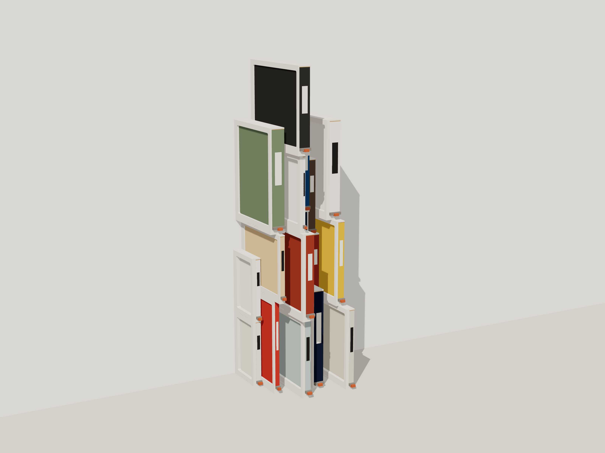
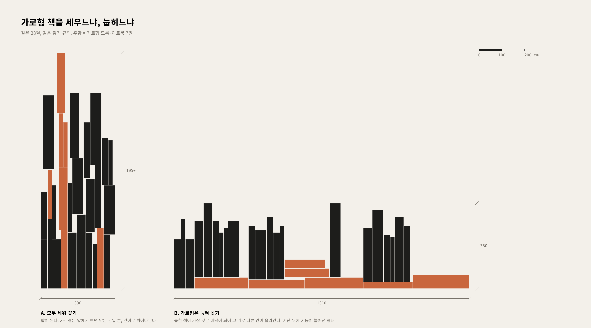

# 책 한 권 = 칸 하나인 책장

책 치수 세 개(높이·너비·두께)를 재면 그 책만을 위한 칸이 3D 프린터용 파일로 나오고,
칸을 하나씩 쌓아 갈수록 책장 윤곽이 장서의 실루엣이 된다.



## 구조 개념

- **바깥은 격자, 안은 책**: 모듈 바깥 치수는 10 mm 격자로 올림하고 안쪽만 책에 딱 맞춘다.
  그 차이는 측벽·뒷벽·바닥판 두께가 흡수한다. 그래서 어떤 모듈끼리도 쌓이고, 위아래는 격자 위의 Ø4 핀으로 맞물린다.
- **책이 네 번째 벽**: 측벽은 한쪽에만 있다(C자 단면). 반대쪽 윗판 모서리는 책이 받친다.
  책이 빠지면 그 칸은 약해진다. 빈 칸에는 같은 치수의 대리 블록을 끼우는 것을 전제로 한다.
- **쌍쐐기로 꺼내기**: 책 밑에 받침(shoe)과 쐐기(wedge)가 겹쳐 있다. 쐐기를 먼저 빼면 받침이 2 mm 내려가
  위에서 누르던 하중이 풀리고, 책은 받침째 가볍게 빠진다.
- **쌓는 규칙**: 들어온 순서대로, 지금 형태에서 가장 낮고 아래 모듈이 받쳐 주는 자리에 놓는다
  (닿는 면이 중심을 포함하고, 깊이의 75%·면적의 40% 이상). 자리가 없으면 옆으로 넓힌다.
  깊은 미술책은 얕은 페이퍼백 위에 거의 올라가지 못해서, 대체로 미술책끼리 겹쳐 높은 봉우리가 되고
  페이퍼백이 그 사이를 채운다. 가장 깊은 가로형 책은 가로형 책 위에만 올라가서 탑 가운데 깊은 기둥 하나로 모인다.
  대신 늦게 들어온 무거운 책이 위로 가서 위가 무거워지므로, 벽 고정이 필수다.
- **세워 꽂기 / 눕혀 꽂기**: `lay = true`면 책등은 앞을 향한 채 두께가 위아래가 된다.
  예시 28권 중 가로형 7권을 세우면 330 × 1050 mm의 탑, 눕히면 눕힌 책이 기단이 되어 1310 × 380 mm로 낮고 길게 퍼진다.




## 파일

| 파일 | 내용 |
|---|---|
| `book_module.scad` | 파라메트릭 모듈 (OpenSCAD). 책 치수를 넣으면 모듈·받침·쐐기·핀이 나온다 |
| `books.json` | 장서 목록 (지금은 예시용 가상 장서 28권: 미술책 14(가로형 7), 철학·인문 페이퍼백 14) |
| `layout.py` | 치수 계산 → 쌓는 위치 → `out/layout.json`, `assembly.scad`, STL |
| `assembly.scad`, `assembly_lay.scad` | 전체 책장 미리보기 (세운 것 / 가로형을 눕힌 것) |
| `render/` | three.js + Playwright 렌더러 |
| `renders/` | 렌더 이미지 |

## 사용법

```bash
# 1) books.json에 책 추가 (id, label, h, w, t, date, color)
# 2) 배치와 STL
python3 layout.py --stl out/stl
#    가로형을 모두 눕힌 변형
python3 layout.py --lay-landscape --out out_lay --stl out_lay/stl --assembly assembly_lay.scad
# 3) 렌더 (render 폴더에서 npm install 한 번)
node render/shoot.mjs            # 또는: node render/shoot.mjs hero silhouette
```

모듈 하나만 뽑을 때는 OpenSCAD에서 `book_module.scad`를 열고 Customizer에서 책 치수와 `part`를 고르면 된다.

## 출력 메모

- 모듈은 **닫힌 측벽(x = 0 면)을 바닥에 눕혀** 출력하면 지지대 없이 나온다. 받침·쐐기는 넓은 면을 바닥에.
- 몇 년씩 하중을 받는 부품이라 PETG 권장.
- A2L 출력 범위(330×320×325) 기준으로 책 높이 약 308 mm까지 한 번에 나온다. 넘으면 OpenSCAD 콘솔에
  `FITS_BED false`가 찍힌다 (나눠 뽑는 기능은 아직 없음).
- 예시 28권의 꽉 채운 부피는 세웠을 때 PETG 약 10.3 kg(권당 평균 370 g), 가로형을 눕혔을 때 약 17.5 kg이다.
  눕힌 칸은 책의 넓은 면 전체를 바닥판·윗판으로 감싸서 재료가 많이 든다 (받침은 리브만 남겨 이미 줄였다).
  실제 출력은 벽 몇 겹과 채움이라 이 값보다 가볍다.
- 책 너비(= 칸 깊이)는 약 326 mm까지. 세우든 눕히든 깊이는 같아서, 이보다 넓은 가로형은 한 번에 안 나온다.

## 아직 검증하지 않은 것

- 핀·쐐기·받침의 공차와 쐐기 경사(책 너비에 따라 약 1:17~1:48)는 시험 출력으로 맞춰야 한다.
- 쌓는 규칙은 기하학적 조건일 뿐 구조 계산이 아니다. 실제로는 벽 고정(뒷벽 열쇠구멍)을 전제로 한다.
- 책장 전체가 넘어지지 않는지, 책이 빠졌을 때 윗판이 얼마나 처지는지는 실물로 재야 한다.
