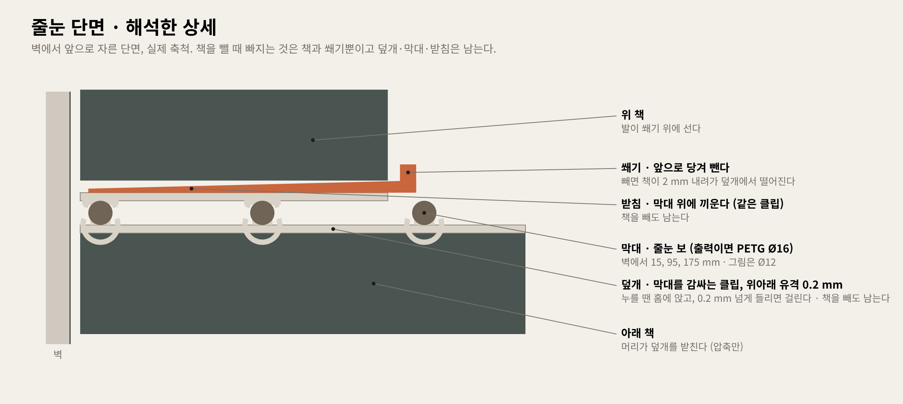

# 2안 구조 해석: 책이 기둥, 막대가 줄눈 보

책을 한 권 빼면 그 책이 받던 하중이 좌우로 넘어가는지, 그리고 그때 무엇이 먼저 문제가 되는지를 계산했다.




## 결론

- **하중은 좌우로 넘어간다.**
  - 04번(위에서 53 N을 받는 책)을 빼면 좌우 16번과 23번이 +27 N, +26 N씩 나눠 받는다.
  - 그 위 막대는 0.3 mm 내려온다.
- **막대를 홈에 얹기만 하면 안 된다.**
  - 20번이나 03번을 빼면 막대 한 줄이 시소처럼 들려 무너진다(불안정).
  - 덮개와 받침이 막대를 붙잡아야 한다(클립).
- **클립은 위아래로 0.2 mm 헐거워야 한다.**
  - 꽉 끼우면, 출력 부품과 책 머리의 맞춤 오차(0~0.3 mm)만으로 클립 하나가 14~31 N에 뽑힌다.
  - 0.2 mm 유격을 두면 Ø16·나무·알루미늄 막대에서 2 N 남짓으로 떨어진다 (Ø12 출력 막대는 5 N).
  - 0.5 mm까지 헐거우면 책을 뺄 때 덮개가 너무 많이 따라 내려온다.
- **막대를 출력한다면 PETG Ø16.**
  - Ø12는 맞춤 오차가 있으면 꺼내기 한도를 넘는다.
  - Ø16은 모든 경우를 통과하지만 여유가 0.1 mm뿐이다.
  - 너도밤나무나 알루미늄 Ø12는 여유가 넉넉하다.
- **가장 위험한 자리는 줄의 끝 책이다** (20번, 23번).

## 계

- **배치** (`runs.py`)
  - 높이가 비슷한 이웃 책들이 한 **줄**(run)을 이룬다.
  - 줄 안의 높이 차이(최대 40 mm)는 책마다 출력하는 받침 높이(14~54 mm)가 흡수한다.
  - 줄의 덮개 위로 x 방향 막대가 이어지고(줄눈 보), 위 줄의 책 받침이 그 막대 위에 선다.
  - 막대 줄은 벽에서 15, 95, 175, 255 mm에 둔다. 각 줄의 막대 수는 그 줄에서 가장 얕은 책 깊이로 정한다.
  - 위 책은 자기가 닿는 막대 줄들 사이에 무게중심이 있어야만 올라간다.
  - 막대는 책이 3권 이상인 줄에만 건다. 둘 이하이면 한 권을 뺐을 때 남은 한 권 위에서 막대와 덮개가 넘어간다(해석으로 확인).
- **이음 (클립)**
  - 덮개와 받침이 막대에 끼워져 늘 남는다. 책을 뺄 때 빠지는 것은 책과 쐐기뿐이다.
  - 클립은 위아래로 0.2 mm 헐겁다. 누를 때는 막대가 홈에 앉고, 0.2 mm 넘게 들릴 때만 걸린다.
- **예시 28권**
  - 456 × 888 mm, 7줄 3단, 무게 48 kg (책, 받침, 덮개, 막대).
  - 가장 긴 막대는 259 mm라 A2L에서 이음 없이 한 번에 출력된다.

## 모델 (`model.py`, `solver.py`)

| 부재 | 모델 |
|---|---|
| 막대 | 줄마다, 막대 줄마다 연속보. 2D 티모셴코 보 요소. 절점은 막대 끝과 모든 접촉점. 자중은 일관 절점 하중 |
| 책, 덮개, 받침 | 강체 (연직 변위, x축 회전, y축 회전) |
| 책 ↔ 덮개, 책 ↔ 받침, 받침 ↔ 바닥 | 압축만 받는 접촉. 두께 방향 가우스 2점 × 깊이 방향 앞뒤 2점 |
| 덮개·받침 ↔ 막대 | 클립. 유격 0이면 양방향 스프링, 유격이 있으면 앉음(압축)과 걸림(유격 넘어 당김) 두 스프링 |

**풀이**: 압축만 받는 접촉 문제는 볼록한 에너지(조각별 2차식)의 최솟점이다.
- **기본**: 뉴턴 방향과 정확한 선 탐색을 쓴다. 접촉이 열리고 닫히는 점을 차례로 지나며 에너지의 최솟점을 찾는다.
- **끝 판정**: 정확한 헤세 행렬로 온전한 걸음(t = 1)을 간 뒤에도 접촉 상태가 그대로면, 그 점이 정확한 해다.
- **막힐 때**: 경계에 걸린 접촉이 켜졌다 꺼졌다 하며 막히는 경우가 있다.
  - 그때는 접촉의 꺾인 곳을 반지름 0.1 mm에서 1e-7 mm까지 차례로 둥글린 에너지로 해 가까이 간다.
  - 그다음 같은 판정으로 끝낸다.
- **접지 스프링**: 모든 자유도에 아주 약한 스프링을 건다(자기 강성의 1e-12배).
  - 그래서 진짜 메커니즘(받침이 모자람)은 변위가 발산하는 것으로 드러난다.
  - 이 스프링이 받은 힘은 전체 하중의 6e-8 이하였다.
- **평형 확인**: 모든 경우에 바닥 반력과 접지 스프링 반력의 합이 전체 하중과 같은지 확인했다(상대 오차 1e-7 이하).

## 검증 (`test_solver.py`, `test_model.py`)

해석기를 쓰기 전에 교과서 해와 손계산으로 확인했다. 13개 모두 통과.

- **캔틸레버**: 끝 처짐, 회전, 고정단 모멘트 (오일러-베르누이, 티모셴코).
- **단순보**: 중앙 하중 PL³/48EI, 등분포 5qL⁴/384EI + 전단 qL²/8κGA.
- **2경간 연속보**
  - 양방향 받침: 반력 13/32, 11/16, −3/32 P.
  - 압축 전용 받침: 끝 받침이 PL³/16EI 들린다.
- **초기 틈**: 처짐이 틈보다 크면 닿고, 작으면 떨어진다.
- **강체**: 지레 법칙, 무게중심이 받침 밖이면 넘어짐 감지, 대각선 두 점 무차별 평형.
- **보 위 블록**과 **메시 무관성**.
- **모델 전체**
  - 책 한 권을 뺀 다리의 처짐을 손계산과 비교했다. 얹기만 한 상세와 클립 상세 모두 1e-5 안.
  - 다 꽂혔을 때 위 책 하중이 아래 책으로 곧장 내려가는지 확인했다.
  - 받침이 없으면 불안정으로 감지되는지 확인했다.
- **접지 스프링**: 결과를 1e-4 안에서 바꾸지 않는다.
- **절점 합치기**: 0.5 mm와 0.05 mm의 결과 차이 4e-6.

## 가정

| 항목 | 값 | 비고 |
|---|---|---|
| PETG 막대 | E 1800 MPa, 장기 ÷ 2.5, 허용 휨응력 8 MPa | 속 100%, 눕혀 출력. 크리프 계수와 허용값은 보수적 가정 |
| 너도밤나무 환봉 Ø12 | E 11000 ÷ 1.6, 허용 18 MPa | 목구조 기준의 장기 하중 계수 수준 |
| 알루미늄 관 Ø12 × 1.5 | E 69000, 허용 70 MPa | |
| 접촉 강성 k_c | 5000 N/mm (500~50000 민감도) | 책 머리 압축 + 출력 부품. **측정 필요** |
| 클립 강성 k_clip | 5000 N/mm (500~50000 민감도) | **측정 필요** |
| 맞춤 오차 | 모든 압축 접촉에 0~0.3 mm 무작위 틈, 3개 표본 | 출력 부품 평탄도, 책 머리 기울기 |
| 받침·덮개 밀도 | PETG × 0.45 | 채움 포함 평균 |
| 꺼내기 | 쐐기를 빼면 책이 2 mm 내려간다. 덮개가 1.5 mm 넘게 따라 내려오면 실패 | 틈 0.5 mm 확보 |

## 결과 (한 권 빼기 28가지, 장기 하중)

표의 Δ는 책을 뺄 때 덮개가 따라 내려온 거리다(한도 1.5 mm).

### 이음 상세 비교

| 막대 | 얹기만 | 클립, 유격 0 | 클립, 유격 0.2 | 클립, 유격 0.5 |
|---|---|---|---|---|
| 출력 PETG Ø12 | 불안정 (03, 20) | 맞춤 오차 시 Δ 1.58 ✗ | 맞춤 오차 시 Δ 1.97 ✗ | Δ 2.21 ✗ |
| 출력 PETG Ø16 | 불안정 (20) | 통과, 클립 24 N | **통과**, Δ ≤ 1.40, 클립 ≤ 2 N | 맞춤 오차 시 Δ 1.78 ✗ |
| 너도밤나무 Ø12 | 불안정 (03, 20) | 통과, 클립 27 N | **통과**, Δ ≤ 1.13, 클립 ≤ 2 N | 통과, Δ ≤ 1.43 |
| 알루미늄 관 Ø12 | 불안정 (03, 20) | 통과, 클립 31 N | **통과**, Δ ≤ 1.03, 클립 ≤ 2 N | 통과, Δ ≤ 1.37 |

- **맞춤 오차와 꽉 낀 클립이 만나면** 문제가 된다.
  - 덮개와 받침은 단단한 판인데 막대 2~3줄을 한꺼번에 잡는다.
  - 오차로 막대들이 조금 어긋나 있으면 클립이 막대를 억지로 맞추느라 서로 당긴다(과구속). 이것이 14~31 N이다.
- **유격 0.2 mm면** 그 정도 어긋남은 클립이 그냥 흡수한다. 시소는 0.2 mm 안에서 멈춘다.
- **유격이 크면** 책을 뺄 때 덮개가 유격만큼 더 내려와 꺼내기 여유를 먹는다. 0.5 mm는 너무 크다.

### 유격 0.2 mm 상세

| 막대 | 완벽한 맞춤 Δ | 맞춤 오차 Δ (최대) | 막대 휨응력 (최대 / 허용) | 클립 뽑힘 (최대) |
|---|---|---|---|---|
| 출력 PETG Ø12 | 1.30 mm | 1.97 mm ✗ | 1.9 / 8 MPa | 5.1 N |
| 출력 PETG Ø16 | 0.84 mm | 1.40 mm | 1.1 / 8 MPa | 2.0 N |
| 너도밤나무 Ø12 | 0.52 mm | 1.13 mm | 3.4 / 18 MPa | 1.9 N |
| 알루미늄 관 Ø12 | 0.34 mm | 1.03 mm | 6.5 / 70 MPa | 1.7 N |

- **응력**은 모든 재료에서 허용값의 1/4 아래다. 막대가 부러질 걱정은 없고, 결정하는 것은 처짐이다.
- **Δ가 가장 큰 책**은 대부분 20번(오른쪽 아래 줄 끝)과 23번(왼쪽 아래 줄 끝)이다.
  - 줄 끝 책을 빼면 그 위 막대가 이웃 하나에만 기대는 캔틸레버가 된다.
  - 위 칸을 줄 끝 책 위에 올리지 않는 배치 규칙(`runs.py --end-rule inner`)으로 줄일 수 있다(아직 계산 안 함).
- **책을 다 꽂았을 때** 가장 많이 받는 책은 04번이다. 53 N, 머리 압력 4.4 kPa.

### 민감도 (유격 0.2, 완벽한 맞춤)

| 막대 | 책이 무를 때 (k_c 500) | 책이 단단할 때 (50000) | 클립 무름 (500) | 클립 단단 (50000) | 단기 하중 |
|---|---|---|---|---|---|
| PETG Ø12 | Δ 1.80 ✗ | 1.23 | 1.42 | 1.29 | 0.92 |
| PETG Ø16 | 1.24 | 0.79 | 0.94 | 0.82 | 0.55 |
| 너도밤나무 Ø12 | 1.02 | 0.48 | 0.59 | 0.51 | 0.44 |
| 알루미늄 관 Ø12 | 0.91 | 0.34 | 0.39 | 0.34 | 0.34 |

### 두 권 동시에 빼기 (참고. 설계 조건 아님)

- 같은 줄에서 이웃한 두 권을 함께 빼는 21가지 중 6가지가 모든 재료에서 불안정하다.
  - 3권짜리 줄 R0의 두 쌍 (16·04, 04·23).
  - 줄 끝의 쌍 (27·20, 02·22, 06·26, 21·03).
- PETG Ø16에서는 19·11 쌍이, Ø12에서는 19·11과 11·27 쌍이 꺼내기 한도를 넘는다.
- 그러니 **한 번에 한 권만 뺀다.**

## 설계 조건 (해석에서 나온 것)

1. **덮개와 받침은 막대에 클립으로 고정한다.** 얹기만 하면 한 권을 빼는 것만으로 막대가 들린다.
2. **클립은 위아래로 0.2 mm 헐겁게.**
   - 꽉 끼우면 출력 오차만으로 클립이 30 N 가까이 당겨진다.
   - 0.2 mm 유격이면 클립이 버틸 힘은 2 N 남짓이다.
   - 안전율을 두어 **클립 하나당 5 N 이상**을 버티면 된다.
3. **막대**
   - 전부 출력하려면 **PETG Ø16**. 맞춤 오차를 0.3 mm 안으로 지켜야 한다.
   - 여유를 원하면 **너도밤나무나 알루미늄 Ø12**.
4. **막대는 책이 3권 이상인 줄에만 건다.**
5. **한 번에 한 권만 뺀다.**

## 하지 않은 것

- **연직 하중만 봤다.** 옆으로 흔들리는 것, 앞으로 넘어지는 것, 사람이 기대거나 당기는 힘은 계산하지 않았다. 벽 고정을 전제로 한다.
- **가정값을 아직 재지 않았다.**
  - 접촉 강성(책이 머리 방향으로 얼마나 눌리는지), 클립 강성, PETG 크리프는 시험 출력과 실제 책으로 재서 가정값을 바꿔야 한다.
  - 특히 책이 무르면 PETG Ø12는 한도를 넘는다.
- **맞춤 오차는 표본 3개만 봤다.** 0~0.3 mm 무작위로 3번 뽑았을 뿐이고, 통계적으로 최악을 보장하지는 않는다.
- **부품 자체의 강도는 보지 않았다.** 덮개·받침 안의 응력, 클립이 깨지는지는 계산하지 않았다.
- **책을 강체로 봤다.** 아주 얇은 책이 휘거나 접히는 것은 다루지 않았다.

## 다시 돌리기

```bash
python3 runs.py                        # 배치 → out/runs/layout.json
python3 structure/test_solver.py       # 해석기 검증
python3 structure/test_model.py        # 모델 검증
python3 structure/analyze.py           # 모든 경우 → out/runs/structure.json (4코어 약 70분)
python3 structure/figure.py && python3 structure/joint.py   # 그림 (PNG 는 render/shoot.mjs)
```
