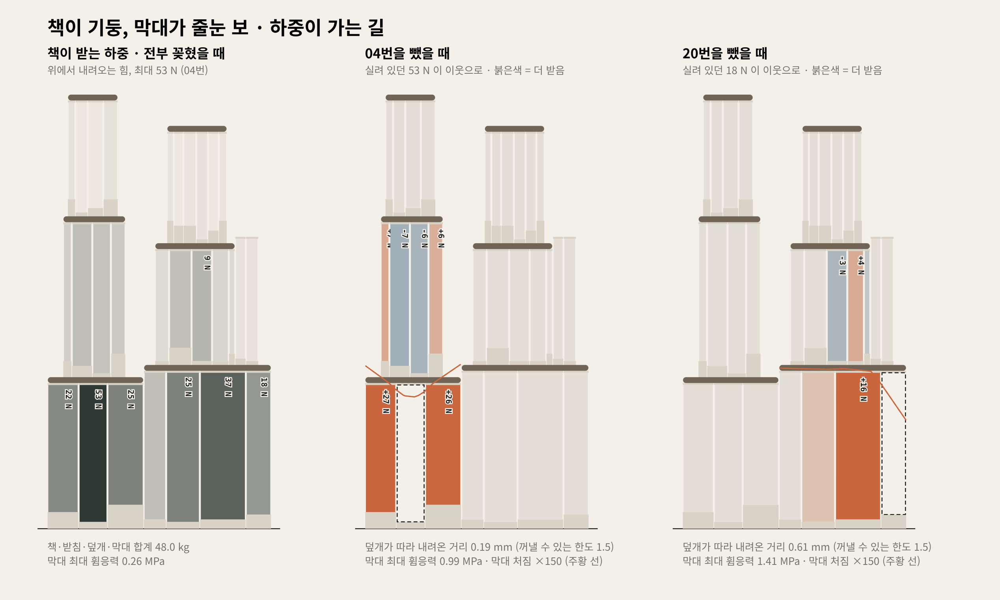

# 2안 구조 해석: 책이 기둥, 막대가 줄눈 보

책을 한 권 빼면 그 책이 받던 하중이 좌우로 넘어가는지, 그리고 그때 무엇이 먼저 문제가 되는지를 계산했다.




## 계

- **배치** (`runs.py`)
  - 높이가 비슷한 이웃 책들이 한 **줄**(run)을 이룬다.
  - 줄 안의 높이 차이(최대 40 mm)는 책마다 출력하는 받침 높이(14~54 mm)가 흡수한다.
  - 줄의 덮개 위로 x 방향 막대가 이어지고(줄눈 보), 위 줄의 책 받침이 그 막대 위에 선다.
  - 막대 줄은 벽에서 15, 95, 175, 255 mm에 둔다. 각 줄의 막대 수는 그 줄에서 가장 얕은 책 깊이로 정한다.
  - 위 책은 자기가 닿는 막대 줄들 사이에 무게중심이 있어야만 올라간다.
  - 막대는 책이 3권 이상인 줄에만 건다(아래 결과 참고).
- **이음** (클립 상세): 덮개와 받침이 막대에 끼워져 늘 남는다. 책을 뺄 때 빠지는 것은 책과 쐐기뿐이다.
- **예시 28권**
  - 456 × 888 mm, 7줄 3단, 무게 48.0 kg (책, 받침, 덮개, 막대).
  - 가장 긴 막대는 259 mm라 A2L에서 이음 없이 한 번에 출력된다.

## 모델 (`model.py`, `solver.py`)

| 부재 | 모델 |
|---|---|
| 막대 | 줄마다, 막대 줄마다 연속보. 2D 티모셴코 보 요소, 절점은 막대 끝과 모든 접촉점 |
| 책, 덮개, 받침 | 강체 (연직 변위, x축 회전, y축 회전) |
| 책 ↔ 덮개, 책 ↔ 받침, 받침 ↔ 바닥 | 압축만 받는 접촉. 두께 방향 가우스 2점 × 깊이 방향 앞뒤 2점 |
| 덮개·받침 ↔ 막대 | 클립 (양방향). 뽑히는 힘을 따로 본다 |
| 하중 | 책, 받침, 덮개 무게. 막대 자중은 일관 절점 하중 |

- **풀이**: 압축 전용 접촉 문제는 볼록한 에너지(조각별 2차식)의 최솟점이다.
  - 감쇠 뉴턴법과 선 탐색으로 푼다.
  - 정칙 행렬로 푼 온전한 걸음 뒤에 접촉 상태가 그대로면, 그 점이 정확한 해다(유한 종료).
- **불안정 판정**: 받침이 모자라면 에너지가 끝없이 내려가 변위가 발산하므로, 그것을 불안정으로 판정한다.
- **평형 확인**: 모든 경우에 바닥 반력의 합이 전체 하중과 같은지 확인한다(상대 오차 1e-9 이하, 실제로는 1e-12 이하).

## 검증 (`test_solver.py`, `test_model.py`)

해석기를 쓰기 전에 교과서 해와 손계산으로 확인했다. 12개 모두 통과.

- **캔틸레버**: 끝 처짐, 회전, 고정단 모멘트 (오일러-베르누이, 티모셴코).
- **단순보**: 중앙 하중 PL³/48EI, 등분포 5qL⁴/384EI + 전단 qL²/8κGA.
- **2경간 연속보**
  - 양방향 받침: 반력 13/32, 11/16, −3/32 P.
  - 압축 전용 받침: 끝 받침이 PL³/16EI 들린다.
- **초기 틈**: 처짐이 틈보다 크면 닿고, 작으면 떨어진다.
- **강체**: 지레 법칙, 무게중심이 받침 밖이면 넘어짐 감지, 대각선 두 점 무차별 평형.
- **보 위 블록**과 **메시 무관성**.
- **모델 전체**: 책 한 권을 뺀 다리를 손계산과 비교. 얹기만 한 상세와 클립 상세 모두 1e-5 안.
- **절점 합치기**: 0.5 mm와 0.05 mm의 결과 차이 4e-6.

## 가정

| 항목 | 값 | 비고 |
|---|---|---|
| PETG 막대 E | 1800 MPa, 장기 ÷ 2.5 | 속 100%, 눕혀 출력. 크리프 계수는 보수적 가정 |
| PETG 장기 허용 휨응력 | 8 MPa | 인장강도 40~45 MPa의 약 1/5 |
| 너도밤나무 환봉 | E 11000 ÷ 1.6, 허용 18 MPa | 목구조 기준의 장기 하중 계수 수준 |
| 알루미늄 관 Ø12 × 1.5 | E 69000, 허용 70 MPa | |
| 접촉 강성 k_c | 5000 N/mm (500~50000 민감도) | 책 압축 + 출력 부품. **측정 필요** |
| 클립 강성 k_clip | 5000 N/mm (500~50000 민감도) | **측정 필요** |
| 받침·덮개 밀도 | PETG × 0.45 | 채움 포함 평균 |
| 꺼내기 | 쐐기를 빼면 책이 2 mm 내려간다. 덮개가 1.5 mm 넘게 따라 내려오면 실패 | 틈 0.5 mm 확보 |
| 클립 허용 | 10 N | 설계 목표값. 아래 결과로 요구값을 다시 정했다 |

## 결과

### 클립 상세, 한 권 빼기 28가지 (장기 하중)

| 막대 | 불안정 | 덮개가 따라 내려옴 (최대) | 막대 휨응력 (최대 / 허용) | 클립 뽑힘 (최대) |
|---|---|---|---|---|
| 출력 PETG Ø12 | 없음 | 0.72 mm (23번) | 1.60 / 8 MPa | 9.7 N |
| 출력 PETG Ø16 | 없음 | 0.32 mm | 0.69 / 8 MPa | 7.3 N |
| 너도밤나무 Ø12 | 없음 | 0.17 mm | 1.63 / 18 MPa | 5.4 N |
| 알루미늄 관 Ø12 | 없음 | 0.09 mm | 3.69 / 70 MPa | 5.4 N |

- 책을 다 꽂았을 때 가장 많이 받는 책은 04번(53 N)이고, 머리 압력은 4.4 kPa다.
- 04번을 빼면 그 53 N이 좌우 16번(+27 N)과 23번(+26 N)으로 넘어간다.

### 비교: 막대를 얹기만 했을 때 (클립 없음)

20번 또는 03번을 빼면 **불안정**해진다. 막대 한 줄이 시소처럼 들린다.

- **20번**
  - 오른쪽 아래 줄의 가장 앞 막대 줄(벽에서 175 mm)에는 깊은 책 09번, 13번만 얹혀 있다. 둘 다 그 줄의 오른쪽 끝 위에 있다.
  - 그 위의 페이퍼백들은 깊이가 얕아 그 막대 줄까지 닿지 않는다.
  - 20번을 빼면 이 막대 줄은 끝에 하중이 걸린 캔틸레버가 되는데, 반대쪽을 눌러 줄 것이 없다.
- **03번**: 맨 위 줄 막대는 아무것도 누르지 않는다. 빠진 책의 덮개가 막대 끝에 매달려 가벼운 막대를 들어 올린다.

덮개가 막대 줄들을 가로로 묶어 주면(클립) 두 경우 모두 안정해진다. 같은 이유로 책이 둘 이하인 줄에서는 한 권을 빼면 막대와 덮개가 남은 한 권 위에서 넘어간다. 그래서 그런 줄에는 막대를 걸지 않는다.

### 민감도 (클립 상세)

- PETG Ø12는 두 경우에 한도에 걸린다.
  - **책이 아주 무를 때** (k_c 500): 덮개가 1.50 mm 내려와 꺼내기 한도와 같다.
  - **클립이 아주 단단할 때** (k_clip 50000): 클립 뽑힘이 11.9 N으로 목표값 10 N을 넘는다.
- PETG Ø16은 클립이 아주 단단할 때 10.6 N으로 목표값을 넘는 것 말고는 모두 통과한다.
- 너도밤나무와 알루미늄은 모든 민감도 경우에 통과한다.

### 맞춤 오차

모든 압축 접촉에 0~0.3 mm의 초기 틈을 무작위로 주고, 경우마다 다시 풀었다.

(계산 중. 결과가 나오면 이 자리에 채운다.)

### 두 권 동시에 빼기 (참고. 설계 조건 아님)

- 같은 줄에서 이웃한 두 권을 함께 빼는 21가지 중 6가지가 불안정하다.
  - 3권짜리 줄 R0의 두 쌍.
  - 줄 끝의 쌍 (27·20, 02·22, 06·26, 21·03).
- PETG Ø12에서는 19·11, 11·27 쌍이 꺼내기 한도를 넘는다.

## 설계 조건 (해석에서 나온 것)

1. **덮개와 받침은 막대에 고정한다.**
   - 얹기만 하면 책 하나를 빼는 것만으로 막대가 들린다.
   - 클립 하나가 받는 최대 뽑힘은 9.7 N이다. 클립이 단단하면 11.9 N까지 간다.
   - 안전율 2를 두면 **클립 하나당 25 N 이상**을 버텨야 한다. 스냅으로 부족하면 핀을 쓴다.
2. **막대는 책이 3권 이상인 줄에만 건다.**
3. **막대 재료**
   - 출력 PETG Ø12는 통과하지만 여유가 적다. 책이 무르거나 크리프가 가정보다 크면 한도에 닿는다.
   - 전부 출력하려면 **PETG Ø16**을 권한다.
   - 너도밤나무나 알루미늄은 여유가 크다.
4. **한 줄에서 이웃한 두 권을 동시에 빼지 않는다.** 하나를 다시 꽂고 다음 책을 뺀다.

## 하지 않은 것

- **연직 하중만 봤다.** 옆으로 흔들리는 것, 앞으로 넘어지는 것, 사람이 기대거나 당기는 힘은 계산하지 않았다. 벽 고정을 전제로 한다.
- **가정값을 아직 재지 않았다.** 접촉 강성(책이 머리 방향으로 얼마나 눌리는지), 클립 강성과 뽑힘 힘, PETG 크리프는 시험 출력과 실제 책으로 재서 이 표의 가정값을 바꿔야 한다.
- **부품 자체의 강도는 보지 않았다.** 덮개·받침 안의 응력, 클립이 깨지는지는 계산하지 않았다.
- **책을 강체로 봤다.** 아주 얇은 책이 휘거나 접히는 것은 다루지 않았다.

## 다시 돌리기

```bash
python3 runs.py                        # 배치 → out/runs/layout.json
python3 structure/test_solver.py       # 해석기 검증
python3 structure/test_model.py        # 모델 검증
python3 structure/analyze.py           # 모든 경우 → out/runs/structure.json
python3 structure/figure.py && python3 structure/joint.py   # 그림 (PNG 는 render/shoot.mjs)
```
