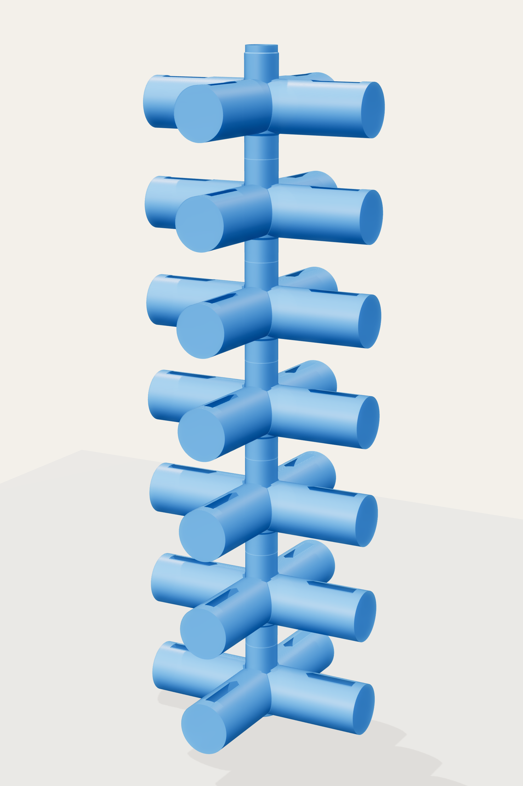
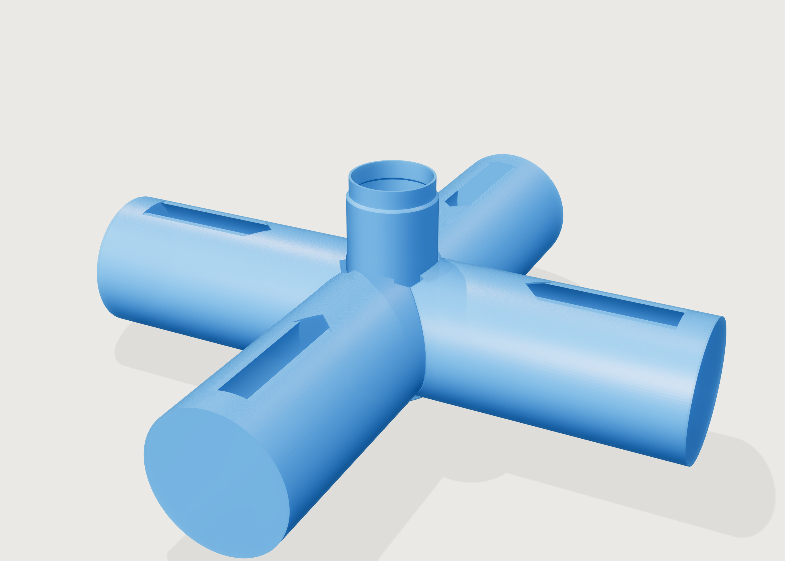

# 허브 화분 아파트

가운데 코어 기둥에 원통 네 개가 십자로 걸린 층을 사람 키(폭 64 cm, 높이 1.77 m)로 쌓는 반투명 PETG 화분이다. 층은 모두 같은 방향으로 쌓아 팔이 위아래로 한 줄씩, 네 줄로 선다.



## 한 층

| 부품 | 층마다 | 출력 크기 (mm) | 필라멘트 | 시간 (보수적) |
|---|---|---|---|---|
| `stl/cross_arm.stl` 팔 | 4 | 140 × 140 × 283 | 279 g | 18.9 h |
| `stl/cross_core.stl` 코어 마디 | 1 | 104 × 104 × 290 | 293 g | 15.9 h |
| `stl/cross_core_base.stl` 맨 아래 코어 마디 | 맨 아래 층만 | 104 × 104 × 225 | 234 g | 12.8 h |

- **팔:** 지름 140, 벽 1.6.
  - 코어 축에서 끝까지 320이라 십자 폭은 640이다.
  - 바깥 끝은 막혔고, 위쪽에 심는 창(150 × 64)이 있다.
  - 이웃 팔과는 45° 대각선 면으로 맞닿는다(틈 0.6).
- **코어:** 지름 90, 벽 2.5, 마디 하나가 한 층(270)이다.
  - 위 끝은 45° 어깨와 18 mm 꽂이다.
  - 위 마디는 바닥 속 모따기로 그 어깨에 앉아, 층 간격이 정확히 270이 된다.
- **맨 아래 층:** 코어 마디가 팔 아랫면 높이에서 끝나므로, 팔 네 개가 바닥에 그대로 놓인다.
- **필라멘트:** 한 층에 약 1.4 kg이고, 7층이면 약 9.8 kg이다.
- **시간:** 7층에 약 640시간이다.
  - PrusaSlicer에 외벽 40 mm/s를 넣은 보수적인 값이다.
  - Bambu Studio의 A2L 설정으로 슬라이싱하면 이보다 짧다.



## 이음: 걸이와 발꿈치


- **걸이 턱:** 코어에 링 두 개가 돈다. 위의 걸이 턱은 45° 경사면이 코어 쪽으로 내려간다. 팔 위 벽이 코어 쪽으로 넘어온 갈고리(너비 50)가 이 경사면에 걸린다(프렌치 클리트).
- **발꿈치:** 팔 아래 안쪽 끝의 발꿈치는 아래 받침 링을 0.6 mm 틈을 두고 마주 본다.
- **짝힘:** 흙 무게로 팔이 처지려 하면, 갈고리는 팔 위를 코어 쪽으로 당기고 받침 링은 팔 아래를 바깥으로 민다. 둘이 짝힘이 되어 버틴다.
- **끼우고 빼기:**
  - 두 링 모두 코어 밖으로 7 mm만 나오고, 팔은 그보다 0.6 mm 바깥에서 끝난다.
  - 그래서 팔을 6 mm 들어 올리면 갈고리가 턱을 넘어, 바깥으로 그냥 빠진다. 끼울 때는 거꾸로 한다.
  - 위층 팔과의 틈이 130 mm라, 위층을 내리지 않고 팔 하나만 빼서 흙을 갈 수 있다.
- **출력:** 팔은 축을 세워 코어 쪽 끝이 위로 가게 뽑는다. 갈고리와 발꿈치에서 아래를 향하는 면은 모두 45°라 서포트가 없다. 코어도 세워 뽑는다. PrusaSlicer로 서포트 없이 슬라이싱해, 허공에 걸치는 벽으로 잡힌 곳이 없음을 확인했다.

### 버티는가 (`check_hang.py`)

45° 경사면은 마찰이 없으면 가로 힘을 세로 힘만큼만 낸다. 팔이 길어 처지는 모멘트가 크기 때문에, 갈고리가 경사면을 타고 올라가지 않게 막는 몫은 마찰이 진다. 아래는 버티는 데 필요한 최소 마찰계수다. 발꿈치 접촉은 보수적으로 받침 링 위 끝(z = −54)에서 잡았다.

| 짐 | 필요 마찰계수 | 갈고리 힘 |
|---|---|---|
| 빈 팔 (279 g) | 0.08 | 5 N |
| 흙 화분 1.5 kg (창 가운데) | 0.12 | 33 N |
| 흙 2.5 kg (창 가운데) | 0.12 | 53 N |
| 흙 2.5 kg (바깥 끝) | 0.20 | 70 N |

- **접촉면 응력:** 갈고리 접촉면이 50 mm × 8 mm이므로 0.2 MPa 아래다. 재료 강도는 문제가 아니다.
- **마찰:** 마찰계수 0.12–0.20은 출력한 PETG 면끼리라면 넘을 것으로 보지만, 재 본 값이 아니다. 게다가 물이 묻고 몇 달 그대로 둔다. 그래서 시험 출력 4번에서 직접 확인한다.
- **미끄러지면:** 걸이 턱과 갈고리 면에 45° 톱니를 내면 마찰 없이 걸린다. 톱니의 모든 면이 45°라 둘 다 서포트 없이 출력된다.

### 전체 탑

- **넘어짐:**
  - 바닥 십자에서 가장 좁은 방향(대각선)의 받침 반지름은 226 mm다.
  - 흙 없는 탑 9.8 kg은 꼭대기를 약 1.3 kgf로 밀면 넘어간다.
  - 팔 28개에 흙을 1.5 kg씩 담으면 52 kg이 되고, 약 6.6 kgf로 밀면 넘어간다.
  - 집에 두려면 벽에 끈으로 묶는다.
- **기둥:** 맨 아래 코어에 걸리는 압축은 흙을 다 채워도 0.7 MPa라 여유가 있다.
- **흔들림:** 코어 이음은 꽂이 틈이 0.25 mm인 대신, 45° 어깨에 면으로 앉아 위 무게가 실리면 가운데로 모인다. 위쪽 층이 가벼울 때 얼마나 흔들리는지는 이음 시험(2번)으로 본다.

## 1 kg 시험 출력


| 번호 | 파일 | 무엇을 보나 | 필라멘트 |
|---|---|---|---|
| 1 | `stl/rings.stl` | 벽 두께 0.8 / 1.2 / 2.0 mm 고리 셋과, 겉면에 세로 홈을 판 1.2 mm 고리 (지름 140, 높이 30) | 92 g |
| 2 | `stl/cross_core_joint.stl` | 코어 쌓기 이음 조각 둘: 아래 끝 30 mm(받는 쪽)와 위 끝 어깨·꽂이 | 64 g |
| 3 | `stl/cross_core.stl` | 코어 마디 하나: 걸이 턱, 받침 링, 꽂이 | 293 g |
| 4 | `stl/cross_arm.stl` | 팔 하나: 갈고리, 발꿈치, 창, 막힌 끝 | 279 g |

합계는 약 730 g이다. 실패해서 한 번 다시 뽑을 몫으로 약 270 g이 남는다.

### 출력 설정

- **슬라이싱:** Bambu Studio에서 STL을 열고 A2L과 뱀부랩 PETG 반투명 기본 설정으로 다시 슬라이싱한다.
  - `slice/a2l_petg.ini`는 시간과 필라멘트를 추정하려고 PrusaSlicer에 A2L 크기를 넣은 설정이다.
  - 거기서 나온 G-code는 A2L에서 쓰지 않는다.
- **방향:** STL에 들어 있는 방향 그대로 뽑는다. 팔은 막힌 끝이 바닥이고, 코어는 꽂이가 위다. 서포트는 끈다.
- **필라멘트:** 반투명 PETG는 65 °C에서 8시간 말려 쓴다.

### 볼 것

1. **고리**
   - 휴대폰 손전등이나 창 앞에 대고 투명도, 빛이 퍼지는 모양, 층 줄무늬를 비교한다.
   - 손으로 눌러 얼마나 휘는지 본다.
   - 팔 벽을 1.6에서 1.2로 줄이면 7층 전체에서 약 1.7 kg이 준다.
2. **쌓기 이음**
   - 꽂이를 끼워 손으로 흔들어 본다.
   - 헐거우면 `cross_floor.scad`의 `clr`를 0.15로, 빡빡하면 0.35로 바꿔 조각만 다시 뽑는다.
3. **코어:** 세운 채 위쪽에 떨림 자국이 있는지 본다(베드슬링어).
4. **걸어 보기 (가장 중요)**
   - 코어를 세워 책상 다리 같은 데 끈으로 단단히 묶는다.
   - 팔을 걸고, 창으로 물 담은 병이나 흙 화분 1.5–2.5 kg을 넣는다.
   - 갈고리 자리에 펜으로 표시하고, 팔 끝 높이를 10분, 하루, 일주일 뒤에 잰다.
   - 표시가 경사면을 타고 올라가면 마찰이 모자란 것이다. 그때는 톱니 걸이로 바꾼다.

## 아직 정하지 않은 것

- **식물 높이:** 층을 같은 방향으로 쌓았으므로, 창 바로 위로 윗층 팔까지 130 mm다. 허브가 이보다 크면 세 가지 중 하나를 고른다.
  - 층 간격을 늘리고 층 수를 줄인다(6층이면 326 → 186 mm, 5층이면 408 → 268 mm).
  - 창을 팔 옆면으로 옮긴다.
  - `twist = 45`로 층을 엇갈린다. 그러면 위아래 두 층 거리인 400 mm까지 자란다.
- **맨 위 마디:** 꽂이가 위로 85 mm 튀어나온다. 뚜껑을 씌울지, 위층을 더 올릴 자리로 남길지 정한다.
- **물:** 팔은 바깥 끝이 막힌 통이라 물이 고인다. 속 화분을 따로 넣을지, 바닥에 배수 구멍을 낼지 정한다.

## 다시 만들기

```bash
openscad -o stl/cross_arm.stl -D 'part="arm"' cross_floor.scad   # arm | core | core_base | core_joint | floor | floor_mid | tower
openscad -o stl/rings.stl -D 'part="rings"' planter_test.scad
prusa-slicer --export-gcode --load slice/a2l_petg.ini -o slice/cross_arm.gcode stl/cross_arm.stl
python3 check_hang.py
python3 render/joint_section.py
node render/shoot.mjs renders/cross_stack7.png "/planter/render/preview.html?parts=cross_floor&stack=7&hf=270&w=1000&h=1500&dir=0.55,0.28,1&zoom=0.82" 1000 1500
node render/shoot.mjs renders/test_prints.png "/planter/render/preview.html?w=1600&h=900&dir=0.25,0.42,1&zoom=0.95" 1600 900
```

`shoot.mjs`와 `joint_section.py`는 저장소 맨 위에서 돌린다. 그 밖의 명령은 `planter/`에서 돌린다.
