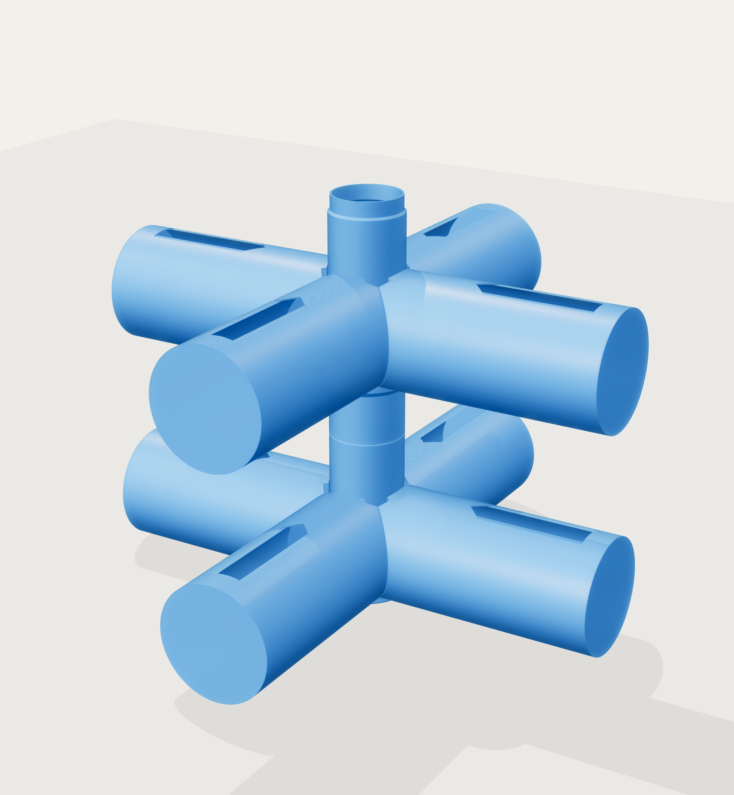
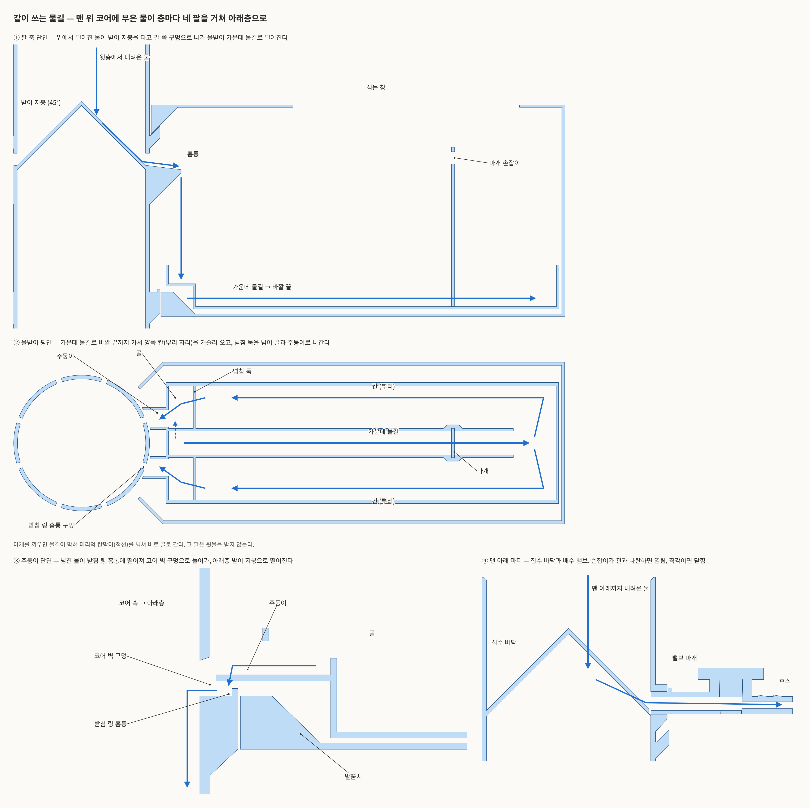
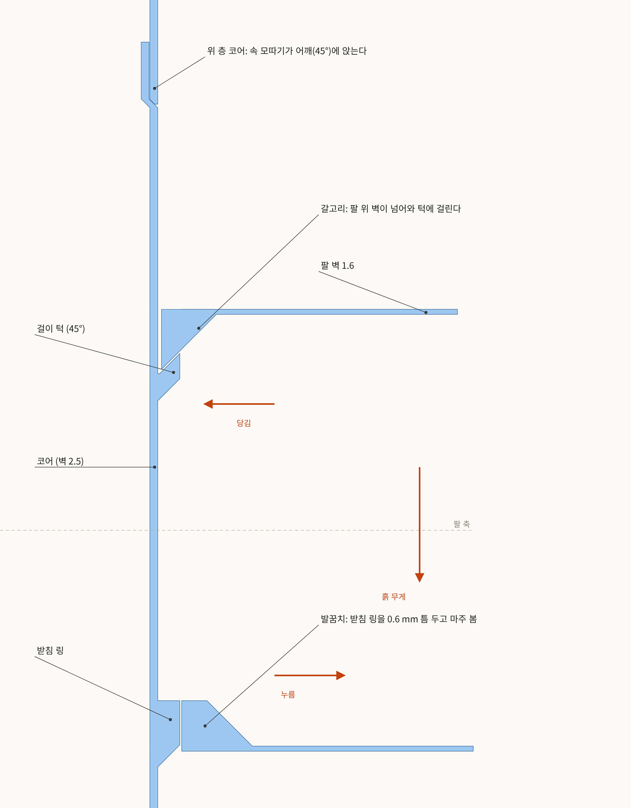
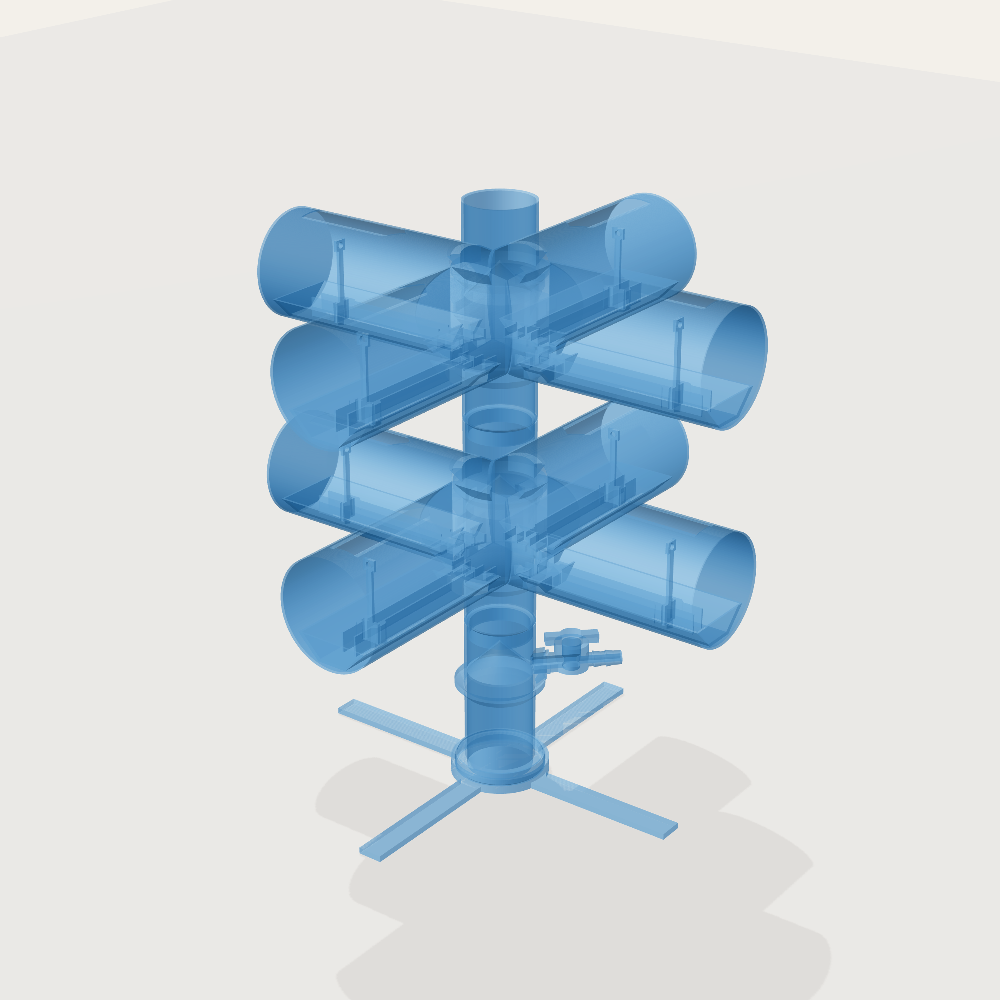
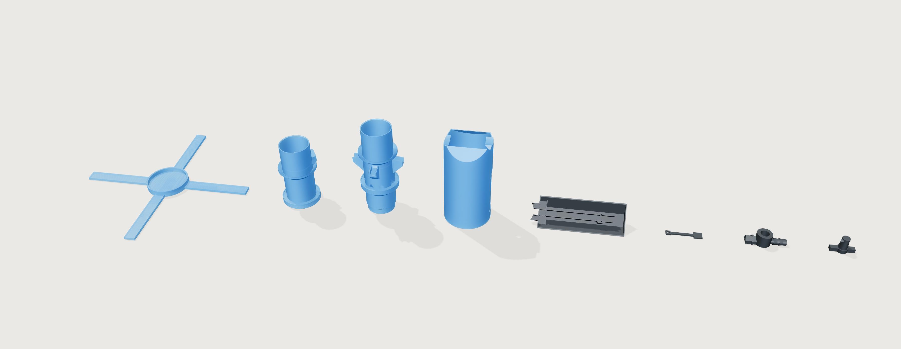
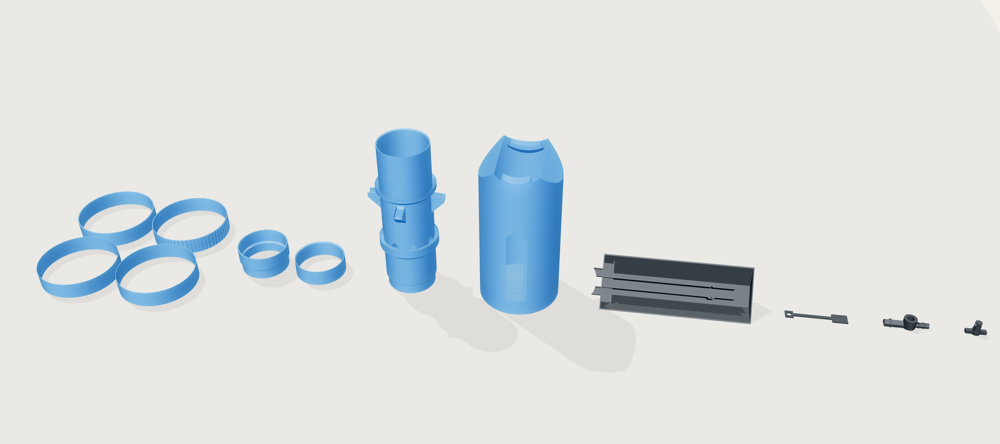

# 허브 화분 아파트

반투명 PETG 화분이다. 가운데 코어 기둥에 원통 네 개가 십자로 걸린 층을 사람 키(폭 64 cm, 높이 1.77 m)로 쌓는다.

- **쌓는 방식:** 층은 모두 같은 방향으로 쌓아, 팔이 위아래로 한 줄씩 네 줄로 선다.
- **물:** 탑 전체가 물 한 줄기를 같이 쓴다. 맨 위 코어에 물을 부으면 위층부터 차례로 네 팔의 물받이를 채우고, 넘친 물이 아래층으로 내려간다.
  - 한 팔의 뿌리가 썩으면 그 물이 아래층 전부로 간다.
  - 팔마다 끼우는 마개로 윗물을 받지 않을 수 있다.
  - 맨 아래 배수 밸브 하나로 탑 전체를 헹궈 낸다.


## 한 층

| 부품 | 층마다 | 출력 크기 (mm) | 필라멘트 | 시간 (보수적) |
|---|---|---|---|---|
| `stl/cross_arm.stl` 팔 | 4 | 140 × 140 × 283 | 279 g | 18.9 h |
| `stl/cross_core.stl` 코어 마디 | 1 | 132 × 132 × 290 | 328 g | 18.5 h |
| `stl/cross_tray.stl` 물받이 (불투명) | 4 | 276 × 67 × 67 | 95 g | 7.2 h |
| `stl/cross_gate.stl` 마개 (불투명) | 4 | 103 × 19 × 2 | 3 g | 0.2 h |
| `stl/cross_core_base.stl` 맨 아래 코어 마디 | 맨 아래 층만 | 104 × 104 × 205 | 240 g | 13.2 h |
| `stl/cross_valve_body.stl` + `cross_valve_plug.stl` 배수 밸브 (불투명) | 맨 아래 층만 | 74 × 22 × 18, 34 × 15 × 24 | 13 g | 1.0 h |

- **팔:** 지름 140, 벽 1.6.
  - 코어 축에서 끝까지 320이라 십자 폭은 640이다.
  - 바깥 끝은 막혔고, 위쪽에 심는 창(150 × 64)이 있다.
  - 코어 쪽 끝은 열려 있다. 위에는 갈고리, 아래에는 발꿈치가 있고, 옆은 이웃 팔과 45° 면으로 맞닿는다(틈 0.6).
- **코어:** 지름 90, 벽 2.5. 마디 하나가 한 층(270)이다.
  - 아래 끝은 45° 어깨와 18 mm 꽂이다. 꽂이가 아래 마디 속으로 들어가고, 어깨는 아래 마디 위 끝의 속 모따기에 앉는다.
  - 위가 아래 속으로 들어가는 홈통 방향이라, 코어 속을 타고 내려온 물이 이음 틈으로 새지 않는다.
  - 층 간격은 정확히 270이다.
- **맨 아래 층 (필로티):**
  - 코어가 팔 아랫면 높이에서 끝나 팔 네 개가 바닥에 놓인다.
  - 이 층은 물길에서 빠진다. 대신 그 코어 위쪽이 집수조이고, 대각선에 배수 밸브가 있다(아래 ④).
  - 물받이를 넣어 심어도 되지만, 그때는 손으로 물을 준다.
- **필라멘트와 시간 (7층 전체):**
  - 반투명 약 10.0 kg, 불투명 약 2.7 kg.
  - 시간은 약 860시간이다. PrusaSlicer에 외벽 40 mm/s를 넣은 보수적인 값이라, Bambu Studio의 A2L 설정이면 이보다 짧다.



## 같이 쓰는 물길



물 한 줄기가 층마다 거치는 길:

1. 코어 속 **받이 지붕**(45° 원뿔)이 위에서 떨어지는 물을 다 받아 벽 쪽으로 보낸다.
2. 팔 방향의 구멍 네 개와 **홈통**을 지나, 팔 안 **물받이**의 가운데 물길로 떨어진다.
3. 가운데 물길을 따라 바깥 끝까지 간 뒤 양쪽 칸(뿌리 자리)으로 나뉜다. 칸을 거슬러 코어 쪽으로 돌아온다.
   - 새 물이 물받이 끝까지 밀고 들어가므로, 헹굴 때 고인 물이 남지 않는다.
4. 물높이가 **넘침 둑**(z = −44)을 넘으면 머리의 골로 넘어가 **주둥이**로 나간다.
5. 주둥이 물은 **받침 링 윗면 홈통**에 떨어져 코어 벽 구멍으로 들어간다. 그 층 지붕 아래라서 그대로 아래층 지붕으로 떨어진다.

- **물끊기 홈:** 홈통 끝과 주둥이 끝 아랫면에 작은 홈이 있다. 물이 적게 흐를 때 아랫면을 타고 되돌아가지 않고 거기서 떨어지게 한다.
- **아래층에서 나뉘는 방식 (가설):**
  - 맨 위에 부은 물은 받이 지붕 꼭대기에 떨어져 네 팔에 고르게 나뉜다.
  - 윗층에서 넘친 물은 받침 링 홈통 구멍(팔 축에서 ±20°)으로 들어가 코어 안쪽 벽을 타고 내려간다. 그래서 아래층에서는 같은 방향 팔로 주로 갈 수 있다.
  - 그렇다면 물은 층마다 섞이지 않고 같은 줄(1~4호 라인)을 따라 내려간다.
  - 반 크기 물 시험 4번으로 확인한다.

- **물받이 한 개:** 물 약 0.26 L. 바닥 모서리가 팔 안쪽 면에 얹힌다.
  - 불투명 필라멘트로 뽑거나 겉을 칠한다. 반투명이면 양액에 녹조가 낀다.
  - 팔을 걸기 전에 코어 쪽 열린 끝으로 비스듬히 밀어 넣는다(몸통이 발꿈치를 넘어가도록).
- **채우기:**
  - 물길에 있는 24개를 다 비운 상태에서 채우려면 약 6.1 L가 든다.
  - 위층부터 차므로, 아래 밸브 호스로 물이 나올 때까지 부어야 다 찬 것이다.
  - 붓는 속도는 분당 2 L 정도까지로 한다. 주둥이 하나가 초당 약 7 mL를 빼므로, 한 층이 분당 약 3 L까지 받는다.
- **마개:**
  - 물받이 가운데 물길의 홈(창 아래, x = 246)에 위에서 끼운다.
  - 끼우면 물길이 차올라 머리의 칸막이(z = −40)를 넘쳐 바로 골로 간다. 그 팔은 윗물을 받지 않고, 직접 물을 채워야 한다.
  - 막히는 것은 받는 쪽뿐이다. 그 팔에서 넘친 물은 여전히 아래로 간다.
- **배수 밸브:**
  - 맨 아래 코어의 집수 바닥(원뿔)에서 대각선으로 관이 나가고, 테이퍼 마개가 그 관을 여닫는다. 손잡이가 관과 나란하면 열림, 직각이면 닫힘이다.
  - 꼭지에 실리콘 호스(안지름 약 8 mm)를 끼워 바닥의 통으로 보낸다.
  - 밸브는 바닥에서 약 14 cm 높이다. 그래서 그보다 낮은 통이면 물이 저절로 흘러간다.
- **헹구기:** 밸브를 열고 맨 위에서 맑은 물을 물받이 부피의 세 배쯤(약 20 L) 부으면, 층마다 고인 물이 차례로 밀려 나간다.
- **새지 않게:**
  - 밸브 관과 코어 구멍 사이, 마개와 마개 통 사이는 출력 그대로면 조금 샌다. 식품용 실리콘 그리스를 바르거나, 마개를 TPU로 뽑는다.
  - 물받이 자체도 출력 벽이 새지 않는지 처음에 물을 담아 확인한다.
- **출력:**
  - 물받이는 한쪽 옆벽을 판에 대고 45° 로 눕혀 뽑는다(STL에 그 방향으로 들어 있다). 바닥, 칸막이, 둑, 주둥이의 아래를 향하는 면이 모두 45°라 서포트가 없다.
  - 코어의 홈통과 받이 지붕도 아랫면이 45°다.
  - PrusaSlicer에서 허공에 걸치는 벽으로 잡힌 곳은 짧은 다리와 작은 곳뿐이다: 코어의 팔 쪽 구멍 윗변(13 mm), 밸브 마개 물길 구멍 윗변(8 mm), 밸브 호스 꼭지의 판 바로 위 둥근 아랫면, 물받이와 맨 아래 코어의 한두 층.
- **조립 확인:** 두 층을 쌓은 모델(23개 부품)로 부품 사이 틈을 쟀다.
  - 팔–코어 0.56, 팔–팔 0.6, 물받이–팔 0.3, 마개–홈 0.2, 코어–코어 0.08 mm.
  - 밸브는 몸통과 마개가 맞닿는다(손잡이가 통 위에 앉는다).
  - 팔과 물받이를 6 mm 들어 올려 바깥으로 빼는 길에서 코어에 닿는 데가 없다. 갈고리 아랫면이 턱 경사면과 나란해서, 45°로 비스듬히 빼도 된다.

## 이음: 걸이와 발꿈치



- **걸이 턱:** 코어에 링 두 개가 돈다. 위의 걸이 턱은 45° 경사면이 코어 쪽으로 내려간다. 팔 위 벽이 코어 쪽으로 넘어온 갈고리(너비 50)가 이 경사면에 걸린다(프렌치 클리트).
- **발꿈치:** 팔 아래 안쪽 끝의 발꿈치가 아래 받침 링을 0.6 mm 틈을 두고 마주 본다. 받침 링 윗면은 물길의 홈통을 겸한다.
- **짝힘:** 팔이 처지려 하면 갈고리는 팔 위를 코어 쪽으로 당기고, 받침 링은 팔 아래를 바깥으로 민다. 둘이 짝힘이 되어 버틴다.
- **끼우고 빼기:**
  - 팔을 6 mm 들어 올리면 갈고리가 턱을 넘어 바깥으로 빠진다. 끼울 때는 거꾸로 한다.
  - 위층 팔과의 틈이 130 mm라, 위층을 내리지 않고 팔 하나만 빼서 손볼 수 있다.

### 버티는가 (`check_hang.py`)

45° 경사면은 마찰이 없으면 가로 힘을 세로 힘만큼만 낸다. 그래서 갈고리가 경사면을 타고 올라가지 않게 막는 몫은 마찰이 진다. 아래는 버티는 데 필요한 최소 마찰계수다. 발꿈치 접촉은 보수적으로 받침 링 위 끝(z = −54)에서 잡았다.

| 짐 | 필요 마찰계수 | 갈고리 힘 |
|---|---|---|
| 빈 팔 (279 g) | 0.08 | 5 N |
| 수경: 물 0.5 L와 심지 0.1 kg | 0.08 | 15 N |
| 흙 화분 1.5 kg (창 가운데) | 0.12 | 33 N |
| 흙 2.5 kg (바깥 끝) | 0.20 | 70 N |

- **수경의 경우:** 물받이(0.26 L, 95 g)로 가면 필요 마찰계수가 0.08 정도라, 출력한 PETG 면끼리면 넉넉할 것으로 본다. 다만 재 본 값은 아니어서 시험 4번에서 확인한다.
- **미끄러지면:** 걸이 턱과 갈고리 면에 45° 톱니를 낸다.

### 전체 탑

- **넘어짐:**
  - 바닥 십자에서 가장 좁은 방향(대각선)의 받침 반지름은 226 mm다.
  - 물까지 채운 탑은 약 19 kg이고, 꼭대기를 약 2.4 kgf로 밀면 넘어간다.
  - 집에 두려면 벽에 끈으로 묶는다.
- **기둥:** 맨 아래 코어에 걸리는 압축은 0.3 MPa 정도라 여유가 있다.

## 물 시험 (반 크기 모델)



`water_test.scad`는 `cross_floor.scad`를 그대로 불러 축척 `k`만 0.5로 바꾼다.

- **실물과 같은 것:**
  - 부품 사이 틈(0.25 / 0.3 / 0.6 mm)과 벽 두께 최소값.
  - 물길 최소 크기: 홈통 8 mm, 받침 링 홈통 5 mm, 주둥이 6 mm, 홈통 구멍 6 mm.
  - 물이 지나는 차례, 그리고 마개·집수조·밸브가 움직이는 방식.
  - 물길이 5 mm 아래로 작아지면 표면장력 때문에 물이 흐르지 않고 매달리므로, 그 아래로는 줄이지 않았다.
- **실물과 다른 것:** 흐르는 양. 물길이 실물보다 상대적으로 굵고 물받이는 27 mL로 작다. 분당 몇 L를 받는지는 실물에서 다시 본다.
- **구성:**
  - 물길 층 두 개. 층마다 코어 1, 팔 4, 물받이 4, 마개 4.
  - 집수조와 밸브가 있는 맨 아래 코어.
  - 맨 아래 층 팔 네 개 대신 십자 발로 세운다(그 층은 물길에서 빠지니 시험에 필요 없다).
  - 크기: 높이 344 mm, 팔 지름 70, 십자 폭 320.



| 파일 (`stl/test/`) | 개수 | 하나 | 시간 (보수적) |
|---|---|---|---|
| `w05_foot.stl` 받침 발 | 1 | 35 g | 2.9 h |
| `w05_core_base.stl` 맨 아래 코어 | 1 | 45 g | 2.7 h |
| `w05_valve_body.stl` + `w05_valve_plug.stl` 밸브 | 1 | 12 g | 0.9 h |
| `w05_core.stl` 코어 | 2 | 65 g | 4.4 h |
| `w05_arm.stl` 팔 | 8 | 36 g | 3.1 h |
| `w05_tray.stl` 물받이 | 8 | 17 g | 1.5 h |
| `w05_gate.stl` 마개 | 8 | 1 g | 0.1 h |

- **합계:** 두 층이면 약 660 g, 53시간이다. 한 층만 먼저 뽑으면 약 375 g, 30시간이다. 아래층에서 물이 어떻게 나뉘는지(4번)를 보려면 두 층이 있어야 한다.
- **필라멘트:**
  - 모두 반투명 파란 PETG로 뽑는다. 물받이도 반투명이면 물높이가 팔 밖에서 보인다.
  - 밸브 마개와 관에는 실리콘 그리스를 바른다.
- **놓는 곳:** 밸브 꼭지가 탁자에서 72 mm 높이라 받는 통은 그보다 낮아야 한다. 모델을 책 몇 권 위에 올리면 편하다.

### 볼 것 (싱크대나 쟁반 위에서)

1. **새는지:** 물받이마다 물을 가득 담아 종이 타월 위에 하루 둔다.
2. **한 층 나누기:** 맨 위 코어 가운데에 물 100 mL를 천천히 붓는다. 네 물받이에 든 양을 주사기로 빼서 잰다.
3. **물길 차례:** 식용 색소를 한 방울 넣고 아래 순서대로 가는지 본다.
   - 홈통 → 가운데 물길 → 바깥 끝 → 양쪽 칸
   - 넘침 둑 → 주둥이 → 받침 링 홈통 → 코어 속
4. **아래층으로 나뉘는 방식:**
   - 윗층 네 물받이가 다 찬 뒤, 한 물받이에만 색소를 넣고 더 붓는다.
   - 아래층 네 물받이 중 어디에 색이 가는지 본다.
   - 같은 줄로만 간다면 그대로 둘지 고를지 정한다.
     - 그대로 둔다면: 같은 라인끼리만 물과 오염을 나누는 모습이 아파트 수직 감염 사례와 닮아 개념에는 맞을 수 있다.
     - 고르게 나누려면: 구멍으로 들어온 물을 지붕 꼭대기로 모아 떨어뜨리는 깔때기를 더한다.
5. **마개:** 한 팔에 마개를 끼우고 부어, 그 물받이 물높이가 그대로인지 본다.
6. **물끊기:** 아주 천천히 부을 때 홈통 끝과 주둥이 끝에서 물이 떨어지는지, 아랫면을 타고 되돌아가는지 본다.
7. **밸브:** 열고 닫아 본다. 닫았을 때 새는지, 열었을 때 집수조가 다 빠지는지 본다.
8. **팔 빼기:** 물이 찬 채로 팔을 6 mm 들어 빼고 다시 끼운다.

층·방향마다(예: 2층 북) 들어간 양과 색이 닿았는지를 표로 적는다.

## 실물 크기 시험 출력

첫 1 kg 스풀은 고리(92 g)와 반 크기 물 시험(약 660 g)에 쓰고, 아래 실물 부품은 다음 스풀로 뽑는다.



| 번호 | 파일 | 필라멘트 | 무엇을 보나 | 무게 |
|---|---|---|---|---|
| 1 | `stl/rings.stl` | 반투명 | 벽 두께 0.8 / 1.2 / 2.0 mm 고리 셋과, 겉에 세로 홈을 판 1.2 mm 고리 | 92 g |
| 2 | `stl/cross_core_joint.stl` | 반투명 | 코어 쌓기 이음 조각 둘: 아래 끝 꽂이·어깨와 위 끝 30 mm | 64 g |
| 3 | `stl/cross_core.stl` | 반투명 | 코어 한 마디: 걸이 턱, 받침 링 홈통, 받이 지붕, 홈통 | 328 g |
| 4 | `stl/cross_arm.stl` | 반투명 | 팔 하나: 갈고리, 발꿈치, 창 | 279 g |
| 5 | `stl/cross_tray.stl` + `cross_gate.stl` | 불투명 | 물받이 하나와 마개 | 98 g |
| 6 | `stl/cross_valve_body.stl` + `cross_valve_plug.stl` | 불투명 | 배수 밸브 | 13 g |

- **반투명:** 1–4번이 약 763 g이다.
- **물받이 색:** 불투명으로 할지, 녹조를 감수하고 반투명으로 할지는 반 크기 시험 뒤에 정한다. 불투명이면 뱀부랩 PETG HF 검정이나 흰색처럼 빛이 안 비치는 색으로 뽑는다.

### 출력 설정

- **슬라이싱:** Bambu Studio에서 STL을 열고 A2L과 뱀부랩 PETG 기본 설정으로 다시 슬라이싱한다.
  - `slice/a2l_petg.ini`는 시간과 필라멘트를 추정하려고 PrusaSlicer에 A2L 크기를 넣은 설정이다.
  - 거기서 나온 G-code는 A2L에서 쓰지 않는다.
- **방향:** STL에 들어 있는 방향 그대로 뽑고, 서포트는 끈다.
  - 팔은 막힌 끝이 바닥이고, 코어는 꽂이가 바닥이다.
  - 물받이는 45°로 눕혔고, 마개와 밸브 몸통은 납작하게, 밸브 마개는 손잡이가 바닥이다.
  - 물받이는 길고(276 mm) 판에 닿는 면이 좁으니 브림을 켠다.
- **필라멘트:** PETG는 65 °C에서 8시간 말려 쓴다.

### 볼 것

1. **고리**
   - 손전등이나 창 앞에 대고 투명도, 빛이 퍼지는 모양, 층 줄무늬를 비교한다.
   - 팔 벽을 1.6에서 1.2로 줄이면 7층 전체에서 약 1.7 kg이 준다.
2. **쌓기 이음**
   - 꽂이를 끼워 손으로 흔들어 본다.
   - 헐거우면 `clr`를 0.15로, 빡빡하면 0.35로 바꿔 조각만 다시 뽑는다.
3. **물 흘려 보기:** 반 크기 시험에서 본 것을 실물 한 팔로 다시 본다. 이번에는 흐르는 양(분당 몇 L까지 넘치지 않고 받는지)과 출력 벽에서 새는지를 본다.
4. **걸어 보기**
   - 코어를 단단히 묶어 세우고 팔을 건다.
   - 물받이를 채우고 0.5 kg쯤 더 얹는다.
   - 갈고리 자리에 펜으로 표시하고, 팔 끝 높이를 10분, 하루, 일주일 뒤에 잰다.

## 아직 정하지 않은 것

- **식물 높이:** 창 바로 위로 윗층 팔까지 130 mm다. 허브가 이보다 크면 셋 중 하나를 고른다.
  - 층 간격을 늘리고 층 수를 줄인다(6층이면 186 mm, 5층이면 268 mm).
  - 창을 팔 옆면으로 옮긴다.
  - `twist = 45`로 층을 엇갈린다.
- **심는 방식:** 창에 걸치는 망 화분(넷팟)과, 물받이 칸까지 내려가는 심지(아크릴·나일론 끈).
- **맨 위 마디:** 위 끝이 그대로 열려 물 붓는 입구가 된다. 깔때기 뚜껑을 둘지 정한다.

## 다시 만들기

`planter/`에서:

```bash
openscad -o stl/cross_tray.stl -D 'part="tray"' cross_floor.scad
# part: arm | core | core_base | core_joint | tray | gate | valve_body | valve_plug
#       floor | floor_water | floor_mid | floor_mid_water | tower (조립 모습)
openscad -o stl/test/w05_arm.stl -D 'part="arm"' water_test.scad   # 반 크기: foot | test_tower 와 위 이름들
openscad -o stl/rings.stl -D 'part="rings"' planter_test.scad
prusa-slicer --export-gcode --load slice/a2l_petg.ini -o slice/cross_tray.gcode stl/cross_tray.stl
python3 check_hang.py
```

저장소 맨 위에서:

```bash
python3 planter/render/joint_section.py
python3 planter/render/water_section.py
node planter/render/shoot.mjs planter/renders/cross_stack7.png "/planter/render/preview.html?parts=cross_floor,cross_floor_water&overlay=1&stack=7&water=1&hf=270&w=1000&h=1500&dir=0.55,0.28,1&zoom=0.82" 1000 1500
node planter/render/shoot.mjs planter/renders/cross_tower.png "/planter/render/preview.html?parts=cross_floor,cross_floor_water&overlay=1&stack=2&water=1&op=0.42&w=1300&h=1300&dir=0.75,0.6,1&zoom=1.3" 1300 1300
node planter/render/shoot.mjs planter/renders/water_test.png "/planter/render/preview.html?parts=test/w05_test_tower&op=0.45&w=1300&h=1300&dir=0.75,0.55,1&zoom=1.15" 1300 1300
node planter/render/shoot.mjs planter/renders/test_prints.png "/planter/render/preview.html?w=1800&h=800&dir=0.15,0.75,1&zoom=0.52" 1800 800
```
